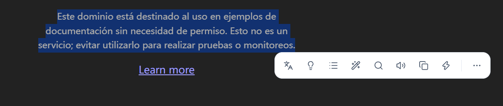
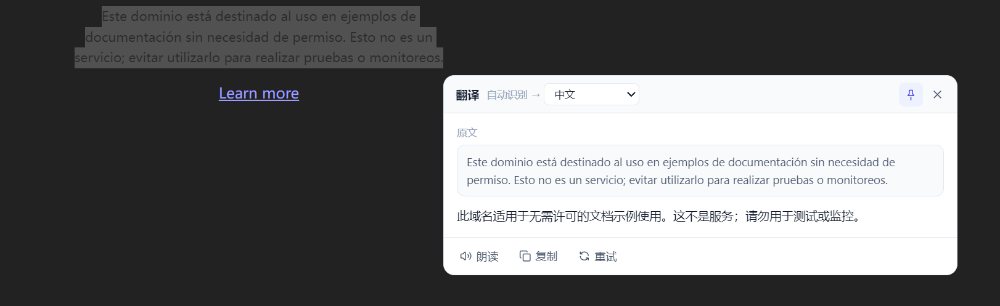

<p align="center">
  
</p>

<h1 align="center">Lexora</h1>

<p align="center">
  <a href="LICENSE"></a>
  <a href="docs/user-guide.md"></a>
  
  <a href="https://github.com/monk233/lexora/actions/workflows/ci.yml"></a>
  <a href="https://github.com/monk233/lexora/releases"></a>
</p>

---

## 简介

Lexora 是 Windows 划词翻译工具。在浏览器、Word、PDF、IDE 等任意应用中选中文字后，光标旁出现浮动工具栏，提供翻译、总结、解释、润色、朗读、复制、搜索。工具栏为非激活浮层，不抢键盘焦点。

## 特性

- **划选触发**：拖动选词、双击单词、三击段落均可唤起工具栏；`Delete`、`Ctrl+C` 等操作仍作用于原应用，继续操作时工具栏自动隐藏。
- **翻译、总结、解释、润色、朗读、复制、搜索**：流式输出，结果按 Markdown 渲染（标题、列表、代码块、表格、链接），可固定、拖动、滚动；搜索默认 Google，可切换百度 / Bing。
- **双引擎**：云端支持任意 OpenAI 兼容接口（DeepSeek / OpenAI / Moonshot / 智谱 / Ollama / LM Studio / 自建服务），可拉取模型列表；本地在应用内安装 llama.cpp 引擎，按功能自动选用腾讯混元 Hy-MT2 1.8B（翻译）或 Qwen2.5 3B（通用），断网可用，两个模型可同时下载。
- **技能可配置**：技能可拖拽排序、增删；内置润色与自定义技能均可改提示词；自定义技能可选 200 个图标、自定义名称与提示词，提示词支持 `{text}`、`{target}`、`{program}` 等变量。
- **截图工具**：点击工具栏「截图」或按自定义快捷键（默认 Win+Shift+X）框选屏幕；可复制图片、提取文字（视觉模型优先，回退本地 OCR）、翻译、解释图片；结果在划词面板中流式显示，支持朗读/复制/重试/追问。自定义技能支持文本/图片两类。
- **截图标注**：形状（矩形 / 圆形 / 直线，描边或实心填充）、箭头（实心三角头 + 锥形尾）、画笔、文本、序号、马赛克；颜色（预设 + 自定义 HSV + 吸色器）与粗细/字号可调，拖动实时预览；点击标注可选中，支持移动 / 缩放 / 旋转与 `Delete` 删除、一步撤回/重做；标注限制在选区内并合成进导出图片。
- **钉在桌面**：把框选（含标注）钉成无边框置顶窗口，可拖动、复制，双击 / `Esc` 关闭；超长图保持可读宽度并在窗口内滚动。
- **长截图（手动滚动）**：选区保持实时可见，侧边预览窗口边滚边拼；支持竖向/横向与上下/左右来回滚动；完成后复制并钉图，取消返回截图界面；全程不自动滚动。
- 截图界面可被系统截图/录屏拍到；截图过程中再次触发截图会被忽略，不会重复抓屏。
- **继续追问**：翻译/总结/解释/润色/自定义结果下方可直接输入问题，多轮流式对话，答案保留在同一面板。
- **单词词典**：英文单词输出音标 + 释义，中文词语输出拼音 + 释义，其他语言仅翻译；英文单词附 3 个可点击追问建议。
- **面板可调**：结果面板右下角可拖拽调整大小并记住，双击手柄恢复自动尺寸。
- **工具栏收纳**：超出宽度的技能自动收进「更多」面板，技能项与配置项以分隔线区分，菜单可滚动；图标选择器默认紧凑，需要时展开 200 图标搜索面板。
- **38 种语言**：覆盖 Hy-MT2 支持的全部语言，含繁体中文、粤语、藏语、哈萨克语、蒙古语、维吾尔语等。
- **便携单文件**：单个 exe（约 10.5 MB），免安装、托盘常驻、静默启动、单实例、可选开机自启；数据保存在 exe 同级 `data/` 目录。
- **状态延续**：本地引擎的启动状态会记住，重启 Lexora 后自动恢复；只有点「停止」才会清除。
- **自动更新**：关于页「检查更新」可自动下载新版本、替换当前 exe 并重启；免安装单文件场景可原地升级，`data/` 目录不受影响。

<p align="center">
  
</p>

<p align="center">
  
</p>

<p align="center">
  
</p>

## 快速开始

### 1. 启动

从 [Releases](https://github.com/monk233/lexora/releases) 下载 `Lexora-<version>-win-x64.exe`，放到任意可写目录，双击。

双击后静默启动，不弹窗口，直接驻留系统托盘。右键托盘图标（或双击托盘图标）打开设置完成配置；再次双击 exe 也只会在后台启动。

### 2. 连接翻译服务

**在线 API**

设置 → 翻译服务 → 选择「在线 API」→ 选择服务商预设 → 填入 API Key → 点「拉取模型」选择模型 →「测试连接」。

**本地模型（离线）**

设置 → 翻译服务 → 选择「本地模型」→ 下载 llama.cpp 引擎 → 下载 Hy-MT2（翻译）、Qwen2.5 3B（通用）或 Qwen2.5-VL 3B（视觉，截图图片理解）→ 点「启动」。之后翻译自动用 Hy-MT2，总结/解释自动用 Qwen2.5 3B，图片理解自动用 Qwen2.5-VL 3B。

### 3. 开始划词

在任意应用中拖动选中文字（或双击单词、三击段落），工具栏随之出现：

| 技能 | 说明 |
| --- | --- |
| 翻译 | 流式翻译为默认目标语言，可在结果面板切换语言 |
| 总结 | 用简体中文提炼要点 |
| 解释 | 用简体中文解释含义、背景与关键概念 |
| 润色 | 输出更通顺的改写结果（提示词可改） |
| 朗读 | 使用 Windows 系统语音朗读，再次点击停止 |
| 复制 | 复制选中文本 |
| 搜索 | 用所选搜索引擎（Google / 百度 / Bing）在浏览器中搜索选中文本 |

自定义技能：设置 → 划词行为 → 工具栏技能 → 从 200 个图标中选图标、填名称与提示词，保存后出现在工具栏。

## 从源码构建

环境：Windows 10/11 x64、Node.js ≥ 20、Rust stable、Visual Studio Build Tools（C++ 桌面开发）、WebView2 Runtime。

```powershell
npm install
npx tauri build --no-bundle     # 产出 src-tauri/target/release/lexora.exe
.\scripts\build-portable.ps1    # 产出 dist/Lexora-<version>-win-x64.exe
```

开发调试：

```powershell
npx tauri dev
# 或
npx tauri build --debug --no-bundle
.\src-tauri\target\debug\lexora.exe --show
```

更多细节见 [构建文档](docs/building.md)、[架构说明](docs/architecture.md)、[v0.3.0 发布说明](docs/release-notes-0.3.0.md)。

## 技术栈

Tauri v2 + Rust（窗口、托盘、全局输入钩子、Windows UI Automation 取词、xcap 截图/长截图拼接）+ 原生 HTML/CSS/JS（WebView2 渲染）+ llama.cpp（本地推理）。前端零构建、零框架，整个应用为约 10.5 MB 的单文件。

## 致谢

- [Tauri](https://tauri.app)（MIT / Apache-2.0）
- [selection-hook](https://github.com/0xfullex/selection-hook)（MIT）
- [llama.cpp](https://github.com/ggml-org/llama.cpp)（MIT）
- [Qwen2.5](https://huggingface.co/Qwen)（Apache-2.0）
- [腾讯混元 Hy-MT2](https://www.modelscope.cn/models/liaowenbin/Hy-MT2-1.8B-Q4_K_M-GGUF)（Apache-2.0）
- [Lucide](https://lucide.dev)（ISC，自定义技能图标库）
- [rdev](https://github.com/Narsil/rdev)（MIT）

## 参与贡献

提交 Issue / PR 前请阅读 [CONTRIBUTING.md](CONTRIBUTING.md) 与 [SECURITY.md](SECURITY.md)。

## License

[MIT](LICENSE) © 2026 Lexora contributors

---

## English

**Lexora** is a selection translator for Windows. Select text in any app — a browser, Word, a PDF, your IDE — and a floating toolbar appears next to the cursor with translate, summarize, explain, polish, read aloud, copy, and search. The toolbar does not take keyboard focus.

- Works with any OpenAI-compatible endpoint, or offline with llama.cpp + GGUF models (Hy-MT2 for translation, Qwen2.5 3B for general tasks); the model is selected per task.
- Results stream in and render as Markdown; the panel can be pinned, moved, resized, and scrolled; search uses Google, Baidu, or Bing.
- Screenshot tools: capture, copy, OCR, translate and explain regions; local annotations (shapes, arrow, pen, text, numbers, mosaic) that can be selected, moved, resized, rotated and undone; pin-to-desktop windows; manual-scroll long screenshots with a live side preview.
- 38 translation languages.
- Reorder, rename, re-icon and re-prompt every skill, including custom skills with `{text}`, `{target}` and `{program}` variables.
- One portable ~10.5 MB exe, tray-resident, optional start-at-login, no installer, no admin rights.

Build from source on Windows with Node.js ≥ 20, Rust, and VS Build Tools:

```powershell
npm install
npx tauri build --no-bundle
```

Docs: [architecture](docs/architecture.md) · [building](docs/building.md) · [user guide](docs/user-guide.md) · [contract](docs/contracts.md).
