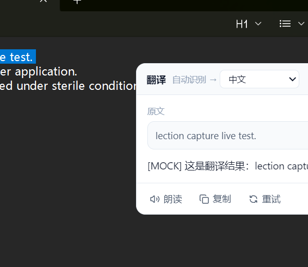
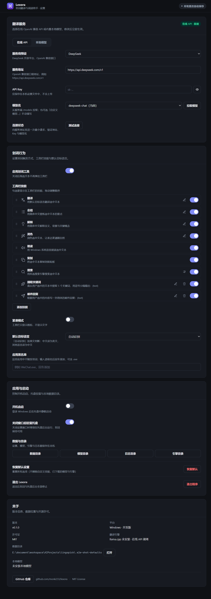

<p align="center">
  
</p>

<h1 align="center">Lexora</h1>

<p align="center"><strong>选中即理解。Select. Understand. Stay in flow.</strong></p>

<p align="center">
  <a href="LICENSE"></a>
  <a href="docs/user-guide.md"></a>
  
  <a href="https://github.com/monk233/lexora/actions/workflows/ci.yml"></a>
  <a href="https://github.com/monk233/lexora/releases"></a>
</p>

---

## 为什么是 Lexora

阅读和写作时，最打断心流的往往不是「看不懂」，而是——复制、切换窗口、粘贴、等待、再切回来。

Lexora 把这些动作收拢成一次划选。在浏览器、Word、PDF、IDE 或任意 Windows 应用里选中一段文字，一个克制的浮动工具栏出现在光标旁：翻译、总结、解释、润色、朗读、复制、搜索，顺手完成。用完即走，焦点始终留在你正在做的事上。

它起于一个简单的执念：**AI 应该像光一样照进来，而不是像一个应用那样打断你。**  
Lexora 取自拉丁词根 *lex*（语言、文字）与 *aura*（光晕、氛围）——语言之光。

## 特性

- **划选即用，不打断**：拖动选词、双击单词、三击段落都能唤起；工具栏是非激活浮层，`Delete`、`Ctrl+C` 等操作照常作用于原应用，一旦你继续工作便自动让路。
- **翻译、总结、解释、润色、朗读、复制、搜索**：流式输出，Markdown 排版（标题、列表、代码块、表格、链接），结果可固定、可拖动、可滚动细读；搜索默认使用 Google，可切换百度 / Bing。
- **双引擎，自由取舍**
  - 云端：任意 OpenAI 兼容接口（DeepSeek / OpenAI / Moonshot / 智谱 / Ollama / LM Studio / 自建服务），模型列表一键拉取。
  - 本地：应用内安装 llama.cpp 引擎，按功能自动选用腾讯混元 Hy-MT2 1.8B（翻译）或 Qwen2.5 3B（通用），断网亦可用。
- **可调校到顺手**：技能可拖拽排序、可增删；内置润色与自定义技能均可改提示词；自定义技能可选 200 个图标、自定义名称与提示词，提示词支持 `{text}`、`{target}`、`{program}` 等变量。
- **38 种语言**：覆盖 Hy-MT2 支持的全部语言，含繁体中文、粤语、藏语、哈萨克语、蒙古语、维吾尔语等。
- **轻若无声**：单个 exe（约 9 MB），免安装、托盘常驻、静默启动、单实例、可选开机自启；数据留在 exe 同级 `data/` 目录。

<p align="center">
  
</p>

<p align="center">
  
</p>

## 快速开始

### 1. 启动

从 [Releases](https://github.com/monk233/lexora/releases) 下载 `Lexora-<version>-win-x64.exe`，放到任意可写目录，双击。

双击后**静默启动**，不弹窗口，直接驻留系统托盘。右键托盘图标（或双击托盘图标）打开设置完成配置；再次双击 exe 也只在后台启动。

### 2. 连接翻译服务

**在线（上手最快）**  
设置 → 翻译服务 → 选择「在线 API」→ 选择服务商预设 → 填入 API Key → 点「拉取模型」选择模型 →「测试连接」。

**离线（隐私优先）**  
设置 → 翻译服务 → 选择「本地模型」→ 下载 llama.cpp 引擎 → 下载 Hy-MT2（翻译）或 Qwen2.5 3B（通用）→ 点「启动」。之后翻译自动用 Hy-MT2，总结/解释自动用 Qwen2.5 3B。

### 3. 开始划词

在任意应用中拖动选中文字（或双击单词、三击段落），工具栏随之出现：

| 技能 | 说明 |
| --- | --- |
| 翻译 | 流式翻译为默认目标语言，可在结果面板切换语言 |
| 总结 | 用简体中文提炼要点 |
| 解释 | 用简体中文讲清含义、背景与关键概念 |
| 润色 | 让选中文字更通顺自然，只输出润色结果（提示词可改） |
| 朗读 | 使用 Windows 系统语音朗读，再次点击停止 |
| 复制 | 复制选中文本 |
| 搜索 | 用选中的搜索引擎（Google / 百度 / Bing）在浏览器中搜索选中文本 |

需要自己的技能？在 设置 → 划词行为 → 工具栏技能 里添加：从 200 个图标中选一个、起名字、写提示词，即刻出现在工具栏。

## 从源码构建

环境：Windows 10/11 x64、Node.js ≥ 20、Rust stable、Visual Studio Build Tools（C++ 桌面开发）、WebView2 Runtime。

```powershell
npm install
npx tauri build --no-bundle     # 产出 src-tauri/target/release/lexora.exe
.\scripts\build-portable.ps1    # 产出 dist/Lexora-<version>-win-x64.exe
```

开发调试：

```powershell
npx tauri dev
# 或
npx tauri build --debug --no-bundle
.\src-tauri\target\debug\lexora.exe --show
```

更多细节见 [构建文档](docs/building.md) 与 [架构说明](docs/architecture.md)。

## 技术栈

Tauri v2 + Rust（窗口、托盘、全局输入钩子、Windows UI Automation 取词）+ 原生 HTML/CSS/JS（WebView2 渲染）+ llama.cpp（本地推理）。前端零构建、零框架，整个应用为一个约 9 MB 的单文件。

## 致谢

- [Tauri](https://tauri.app)（MIT / Apache-2.0）
- [selection-hook](https://github.com/0xfullex/selection-hook)（MIT，取词思路与兼容性处理参考）
- [llama.cpp](https://github.com/ggml-org/llama.cpp)（MIT）
- [Qwen2.5](https://huggingface.co/Qwen)（Apache-2.0）
- [腾讯混元 Hy-MT2](https://www.modelscope.cn/models/liaowenbin/Hy-MT2-1.8B-Q4_K_M-GGUF)（Apache-2.0）
- [Lucide](https://lucide.dev)（ISC，自定义技能图标库）
- [rdev](https://github.com/Narsil/rdev)（MIT）

## 参与贡献

欢迎提交 Issue / PR，请先阅读 [CONTRIBUTING.md](CONTRIBUTING.md) 与 [SECURITY.md](SECURITY.md)。

## License

[MIT](LICENSE) © 2026 Lexora contributors

---

## English

<p align="center"><strong>Select. Understand. Stay in flow.</strong></p>

**Lexora** is a featherweight Windows selection assistant. Select text anywhere — a browser, Word, a PDF, your IDE — and a quiet floating toolbar appears next to the cursor with **translate, summarize, explain, read aloud, and copy**. The toolbar never steals focus; the moment you keep working, it steps aside.

- Works with any OpenAI-compatible endpoint, or fully offline with llama.cpp + GGUF models (Hy-MT2 for translation, Qwen2.5 3B for general tasks) — the right model is picked for you.
- Translate, summarize, explain, polish, read aloud, copy, or search the web — with Markdown-rendered results, a pinnable panel, and Google/Baidu/Bing search.
- 38 translation languages, Markdown-rendered results, draggable and pinnable panel.
- Reorder, rename, re-icon and re-prompt every skill — including your own custom skills with `{text}`, `{target}` and `{program}` variables.
- One portable ~9 MB exe, tray-resident, optional start-at-login, no installer, no admin rights.

Build from source on Windows with Node.js ≥ 20, Rust, and VS Build Tools:

```powershell
npm install
npx tauri build --no-bundle
```

Docs: [architecture](docs/architecture.md) · [building](docs/building.md) · [user guide](docs/user-guide.md) · [contract](docs/contracts.md).
